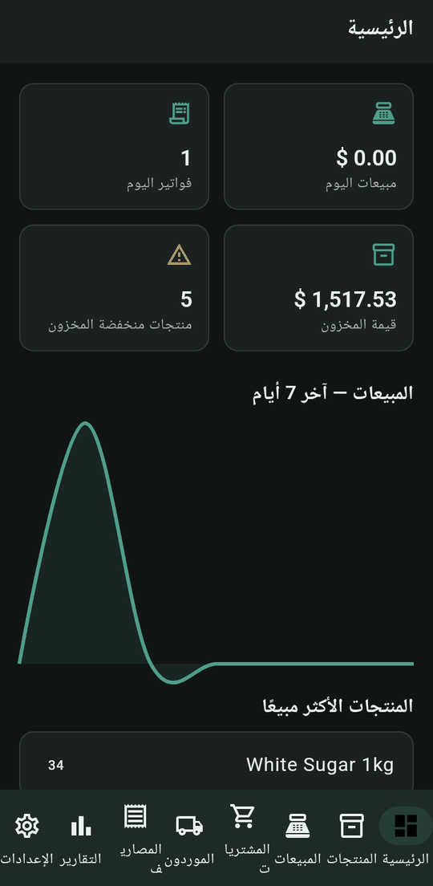
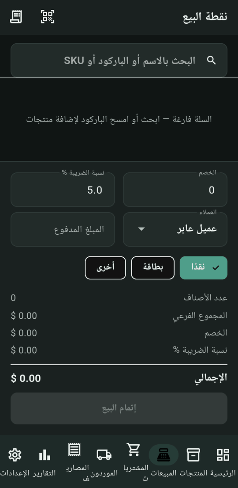
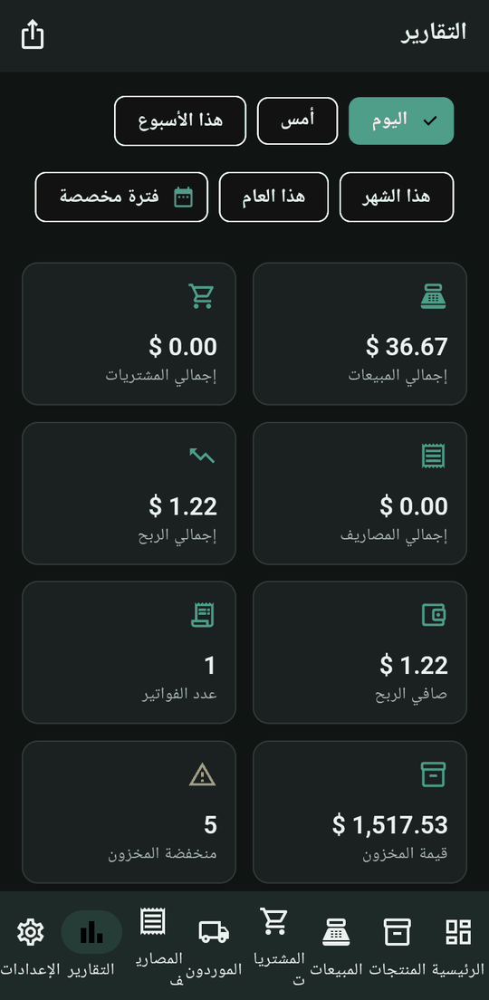
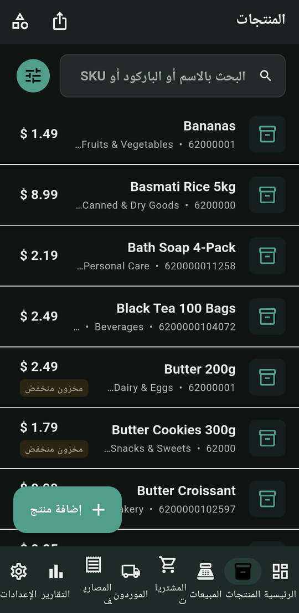
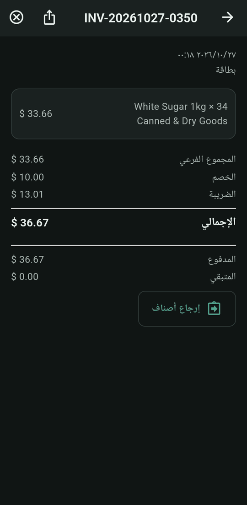
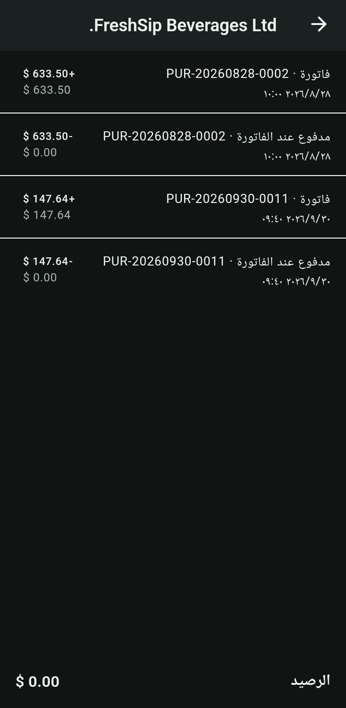
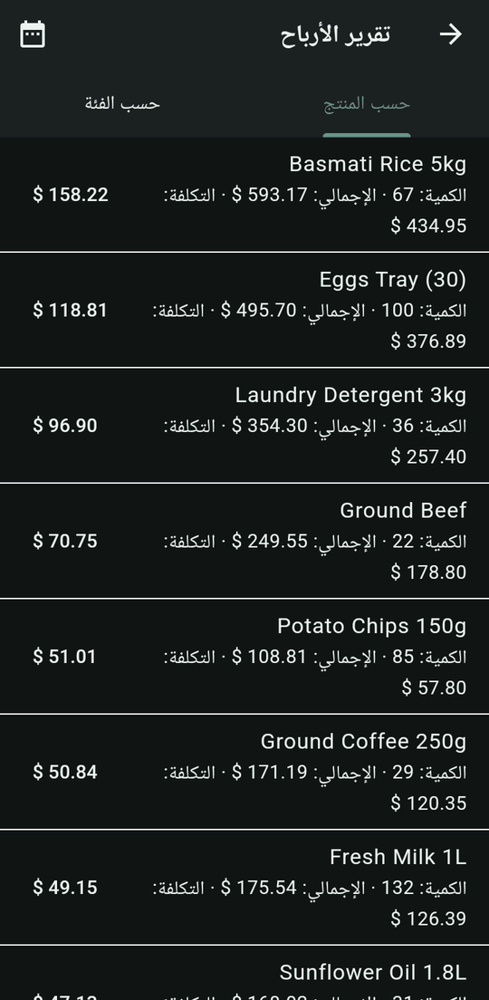
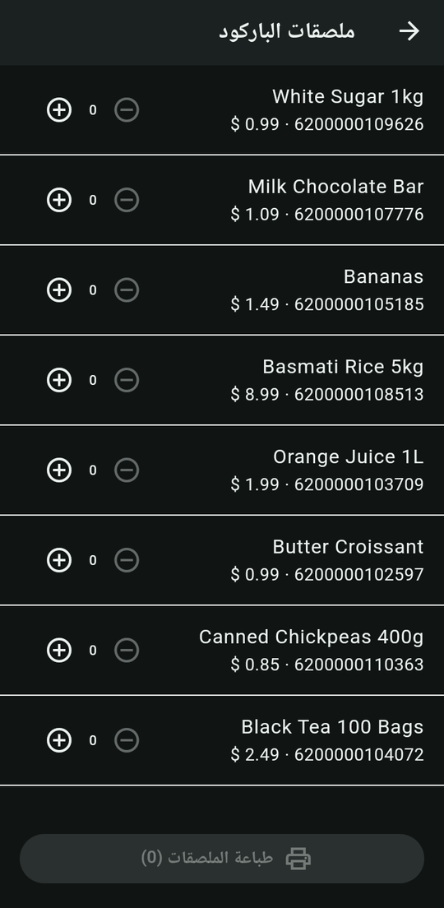

<div dir="rtl" align="right">

# تطبيق إدارة السوبرماركت


<p align="center">



</p>

## نبذة عن التطبيق

تطبيق بواجهة عربية (RTL) يجمع عمليات المتجر اليومية في مكان واحد: البيع، والمخزون، والمشتريات، والموردين، والمصاريف، والتقارير. يمكن عرضه بالوضع الداكن أو الفاتح أو حسب النظام.

## الميزات الظاهرة في الشاشات

| القسم | ما يظهر في التطبيق |
|---|---|
| لوحة التحكم | فواتير اليوم، مبيعات اليوم، المنتجات منخفضة المخزون، قيمة المخزون، رسم مبيعات آخر 7 أيام، الأكثر مبيعاً |
| المنتجات | بحث بالاسم/SKU/الباركود، تصفية وترتيب، تصنيفات، صورة المنتج، سعر البيع والشراء، حد أدنى للمخزون، ضريبة، وحدة، تاريخ صلاحية، تصدير المخزون (xlsx) |
| نقطة البيع | بحث أو مسح باركود، سلة، خصم، ضريبة، اختيار عميل، المبلغ المدفوع، الدفع نقداً أو بطاقة أو غيره |
| الفواتير | سجل مبيعات وبحث وتصفية بالتاريخ، تفاصيل الفاتورة، إرجاع أصناف، إلغاء، تصدير/طباعة (PDF، إيصال حراري، TXT، DOCX، XLSX) |
| المشتريات والموردون | فواتير الشراء، المدفوع والمتبقي، إرجاع للمورد، بيانات الموردين، كشف حساب مورد |
| المصاريف | أنواع مصاريف (إيجار، رواتب، كهرباء، نقل، صيانة، أخرى) مع المبلغ والتاريخ والملاحظات |
| التقارير | فترات: اليوم، أمس، الأسبوع، الشهر، السنة، مخصصة؛ صافي الربح وهامشه؛ الأكثر والأقل مبيعاً؛ تصدير إلى Excel وWord |
| أدوات العمل | العملاء، الوردية/الصندوق، تقرير الأرباح (حسب التصنيف/المنتج)، تنبيهات المخزون (الراكد/قرب الانتهاء)، ملصقات الباركود |
| البيانات والأمان | قفل بكلمة مرور، نسخ احتياطي محلي، نسخ تلقائي، رفع/استعادة عبر Google Drive |
| الإعدادات | بيانات المتجر وشعاره، العملة، الضريبة الافتراضية، عرض الإيصال الحراري، 5 لغات (العربية، English، Deutsch، Français، Русский) |

## لقطات إضافية

<p align="center">





</p>

جميع الصور متاحة في [`assets/screens`](assets/screens).

## بنية المستودع

```
.
├── index.html          صفحة الهبوط
├── css/style.css
├── js/main.js
├── assets/screens/     لقطات الشاشة (PNG)
├── docs/               وثيقة Word وعرض PowerPoint
├── .nojekyll
└── README.md
```

## المتطلبات

لا يوجد. صفحة ثابتة (HTML/CSS/JavaScript) بلا إطار عمل ولا مكتبات خارجية ولا Backend، وتعمل دون اتصال بالإنترنت.

## تشغيل الصفحة محلياً

افتح `index.html` في المتصفح مباشرة، أو شغّل خادماً محلياً:

```bash
python3 -m http.server 8000
# ثم افتح http://localhost:8000
```

## النشر على GitHub Pages

1. أنشئ مستودعاً جديداً على GitHub وارفع محتويات هذا المجلد في جذر المستودع.
2. من **Settings → Pages**.
3. اختر **Deploy from a branch**، ثم الفرع `main` والمجلد `/ (root)`، واضغط **Save**.
4. بعد دقائق يظهر الرابط: `https://<username>.github.io/<repo>/`.

كل المسارات نسبية، لذا تعمل الصفحة من أي اسم مستودع.

## التواصل

- الهاتف: [0933968244](tel:0933968244)
- البريد الإلكتروني: [dev.alihussainhabib@gmail.com](mailto:dev.alihussainhabib@gmail.com)

</div>
